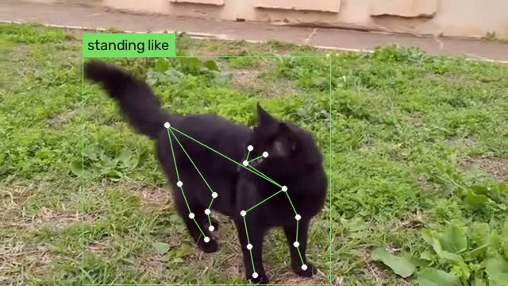

# Cat Pose Monitor

用摄像头、视频或图片观察猫咪姿态。Demo 在画面上标出猫的位置和可见的骨架关键点，并支持导出逐帧坐标。适合先验证猫砂盆机位能否看清肩、髋和爪。



## 运行

需要 Python 3.11 或以上。已在 Linux x86-64、Python 3.14 和 CPU 推理环境验证。第一次运行会从模型发布方下载约 72 MB 的权重，校验后保存在 `models/`。

```bash
git clone https://github.com/zhuzihao127-pixel/cat-pose-monitor.git
cd cat-pose-monitor
python3 -m venv .venv
source .venv/bin/activate
python -m pip install -r requirements.txt
```

用仓库里的真实猫视频试跑，同时输出带骨架的视频和逐帧记录。

```bash
python -m cat_pose_monitor --source examples/cat-walking.mp4 --no-display \
  --output output/annotated.mp4 --jsonl output/poses.jsonl
```

用本机摄像头预览。按 `Q` 或 `Esc` 退出，摄像头编号通常从 `0` 开始。

```bash
python -m cat_pose_monitor --camera 0
```

用照片检查关键点是否被猫砂盆挡住。

```bash
python -m cat_pose_monitor --source cat.jpg --no-display --output output/pose.jpg
```

## 输出

YOLOX-Tiny 检测猫，RTMPose-M 用 AP-10K 的定义定位 17 个关键点，包括眼、鼻、颈、尾根、肩、髋和四只爪。姿态标签基于同侧肩、髋和爪的相对位置。

| 标签 | 含义 |
| --- | --- |
| `standing_like` | 站立样，包含走动时四肢较伸展的画面 |
| `sitting_like` | 坐姿样，前肢较伸展，后躯较低 |
| `low_posture` | 肩和髋都靠近爪所在的高度，例如部分蹲伏或趴卧画面 |
| `uncertain` | 有猫框，姿态依据不足或两侧判断冲突 |

这组几何规则以侧视、水平地面和可见四肢为假设。斜视、遮挡、猫迈步时会出现待判断和误判。项目当前输出的是视觉姿态。

`--jsonl` 每帧记录一个对象，包含从 `0` 开始的 `frame_index`、相对时间 `timestamp_s` 和 `cats`。文件视频时间以帧序号和标称帧率计算，摄像头时间从收到第一帧起按单调时钟计算。每只检测到的猫包括 `bbox_xyxy`、`posture` 和带模型原始分数的 `keypoints`。坐标单位为输入图像像素，低分点坐标写为 `null`。无猫框时 `cats` 为空数组。

## 验证范围

在随仓库提供的 6 秒视频中，Demo 处理了 72 帧，其中 61 帧检出猫，38 帧输出站立样，23 帧保留待判断。另用两张照片检查了坐姿样和低姿态分支。USB 摄像头和 Jetson Nano 4GB 实机仍需验证。当前桌面版使用 ONNX Runtime CPU，模型文件采用 ONNX 格式。

## 来源

- 猫检测使用 [YOLOX-Tiny ONNX](https://github.com/Megvii-BaseDetection/YOLOX/releases/tag/0.1.1rc0)，关键点使用 [MMPose RTMPose-M](https://github.com/open-mmlab/mmpose/tree/main/configs/animal_2d_keypoint/rtmpose/ap10k) 和 [AP-10K](https://github.com/AlexTheBad/AP-10K)。推理接口来自 [rtmlib](https://github.com/Tau-J/rtmlib)。权重遵循上游条款。
- `examples/cat-walking.mp4` 来自 Dzkouslavia 的 [Black Cat walking.webm](https://commons.wikimedia.org/wiki/File:Black_Cat_walking.webm)，采用 [CC0 1.0](https://creativecommons.org/publicdomain/zero/1.0/)。本仓库裁取并转码了片段，`examples/preview.jpg` 是同一片段叠加推理结果后的截图。
- 本仓库代码采用 [MIT 许可证](LICENSE)。
