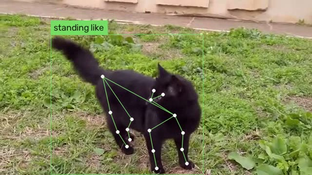

# Cat Pose Monitor

用摄像头、视频或图片观察猫咪姿态。Demo 在画面上标出猫的位置和可见的骨架关键点，并支持导出逐帧坐标。适合先验证猫砂盆机位能否看清肩、髋和爪。



[查看 RTX 3090 的 6 秒演示视频](examples/cat-pose-rtx3090.mp4)

## 运行

需要 Python 3.11 或以上。已在 Linux x86-64、Python 3.14 和 CPU 推理环境验证。第一次运行会从模型发布方下载约 72 MB 的权重，校验后保存在 `models/`。

```bash
git clone https://github.com/zhuzihao127-pixel/cat-pose-monitor.git
cd cat-pose-monitor
python3 -m venv .venv
source .venv/bin/activate
python -m pip install -r requirements.txt
```

用仓库里的真实猫视频试跑，同时输出带骨架的视频和逐帧记录。

```bash
python -m cat_pose_monitor --source examples/cat-walking.mp4 --no-display \
  --output output/annotated.mp4 --jsonl output/poses.jsonl
```

用本机摄像头预览。按 `Q` 或 `Esc` 退出，摄像头编号通常从 `0` 开始。

```bash
python -m cat_pose_monitor --camera 0
```

用照片检查关键点是否被猫砂盆挡住。

```bash
python -m cat_pose_monitor --source cat.jpg --no-display --output output/pose.jpg
```

## 纯视觉连续监测

`--monitor` 将逐帧骨架组成时间序列，画面旁显示移动、身体活动、静止以及有效的静止持续时间。整个流程使用现有预训练权重和可检查的几何、时间规则，所需新增训练标签为零。

```bash
python -m cat_pose_monitor --source examples/cat-walking.mp4 --monitor --no-display \
  --output output/monitor.mp4 --jsonl output/monitor.jsonl --events output/events.json
```

固定相机后，可用 `--roi X1 Y1 X2 Y2` 指定猫砂盆的监测矩形，坐标范围为 0 到 1。默认监测整幅画面。猫框中心进入矩形时开始记录一个可见片段。下例将画面中间区域作为监测范围。

```bash
python -m cat_pose_monitor --camera 0 --roi 0.1 0.1 0.9 0.9 \
  --jsonl output/live.jsonl --events output/live-events.json
```

每个片段记录开始时间、最后看到猫的时间、有效观测时长、各动作累计时长，以及最长连续静止和低姿态时长。`review_reasons` 按演示阈值标出持续静止、持续低姿态或动作证据不足的片段，供人工回看。具体阈值位于 `temporal.py`，需通过实际机位数据校准。

低可信关键点会令动作状态进入 `unknown`。短暂漏检中断动作计时，超过 1 秒的漏检结束当前可见片段，并记为 `visibility_lost`。猫框中心连续处于区域外 0.4 秒后记录 `left_roi`。视频开始或结束时猫已在画面中，会保留对应边界信息。只有一只猫可见时才计算连续动作，多猫画面记为 `multiple_cats`。

这些输出描述画面中的运动和姿态。排尿产出、排便类型和病情需要进一步的事件标注与验证。手持镜头、遮挡和远距离小目标会影响关键点与片段统计。

## NVIDIA GPU

桌面 NVIDIA GPU 可在独立虚拟环境中安装 `requirements-gpu.txt`，然后加上 `--device cuda`。该依赖组合使用 ONNX Runtime 1.26、CUDA 12 和 cuDNN 9。启动时会校验两个模型的 CUDA 执行后端。

```bash
python3 -m venv .venv-gpu
source .venv-gpu/bin/activate
python -m pip install -r requirements-gpu.txt
python -m cat_pose_monitor --source examples/cat-walking.mp4 --monitor --device cuda \
  --no-display --output output/gpu-monitor.mp4 --events output/gpu-events.json
```

时序逻辑的回归检查覆盖漏检、区域边界、多猫、视频裁切边界、不同帧率和往复动作。

```bash
python -m unittest discover -s tests -v
```

## 输出

YOLOX-Tiny 检测猫，RTMPose-M 用 AP-10K 的定义定位 17 个关键点，包括眼、鼻、颈、尾根、肩、髋和四只爪。姿态标签基于同侧肩、髋和爪的相对位置。

| 标签 | 含义 |
| --- | --- |
| `standing_like` | 站立样，包含走动时四肢较伸展的画面 |
| `sitting_like` | 坐姿样，前肢较伸展，后躯较低 |
| `low_posture` | 肩和髋都靠近爪所在的高度，例如部分蹲伏或趴卧画面 |
| `uncertain` | 有猫框，姿态依据不足或两侧判断冲突 |

这组几何规则以侧视、水平地面和可见四肢为假设。斜视、遮挡、猫迈步时会出现待判断和误判。项目当前输出的是视觉姿态。

`--jsonl` 每帧记录一个对象，包含从 `0` 开始的 `frame_index`、相对时间 `timestamp_s` 和 `cats`。文件视频时间以帧序号和标称帧率计算，摄像头时间从收到第一帧起按单调时钟计算。每只检测到的猫包括 `bbox_xyxy`、`posture` 和带模型原始分数的 `keypoints`。坐标单位为输入图像像素，低分点坐标写为 `null`。无猫框时 `cats` 为空数组。

## 验证范围

在随仓库提供的 6 秒视频中，Demo 处理了 72 帧，其中 61 帧检出猫，38 帧输出站立样，23 帧保留待判断。另用两张照片检查了坐姿样和低姿态分支。USB 摄像头和 Jetson Nano 4GB 实机仍需验证。当前桌面版使用 ONNX Runtime CPU，模型文件采用 ONNX 格式。

纯视觉时序版本在 RTX 3090 上运行了 20.2 秒的真实猫砂盆水印预览，共处理 505 帧，489 帧检出猫，形成一个覆盖约 20 秒的可见片段。片段中猫低头、转身并活动前肢，盆沿和俯视角度影响了具体姿态判断。该样本两端都已在盆内，事件文件记录了视频边界。样本来源为 [Storyblocks — Domestic Cat Digs In Litter Box](https://www.storyblocks.com/video/stock/domestic-cat-digs-in-litter-box-captured-indoors-cat-toilet-349025949)，本地运行日志位于 `output/litter-visual-events.json`。

## 来源

- 猫检测使用 [YOLOX-Tiny ONNX](https://github.com/Megvii-BaseDetection/YOLOX/releases/tag/0.1.1rc0)，关键点使用 [MMPose RTMPose-M](https://github.com/open-mmlab/mmpose/tree/main/configs/animal_2d_keypoint/rtmpose/ap10k) 和 [AP-10K](https://github.com/AlexTheBad/AP-10K)。推理接口来自 [rtmlib](https://github.com/Tau-J/rtmlib)。权重遵循上游条款。
- `examples/cat-walking.mp4` 来自 Dzkouslavia 的 [Black Cat walking.webm](https://commons.wikimedia.org/wiki/File:Black_Cat_walking.webm)，采用 [CC0 1.0](https://creativecommons.org/publicdomain/zero/1.0/)。本仓库裁取并转码了片段，RTX 3090 演示视频和预览图在该片段上叠加了推理结果。
- 本仓库代码采用 [MIT 许可证](LICENSE)。
